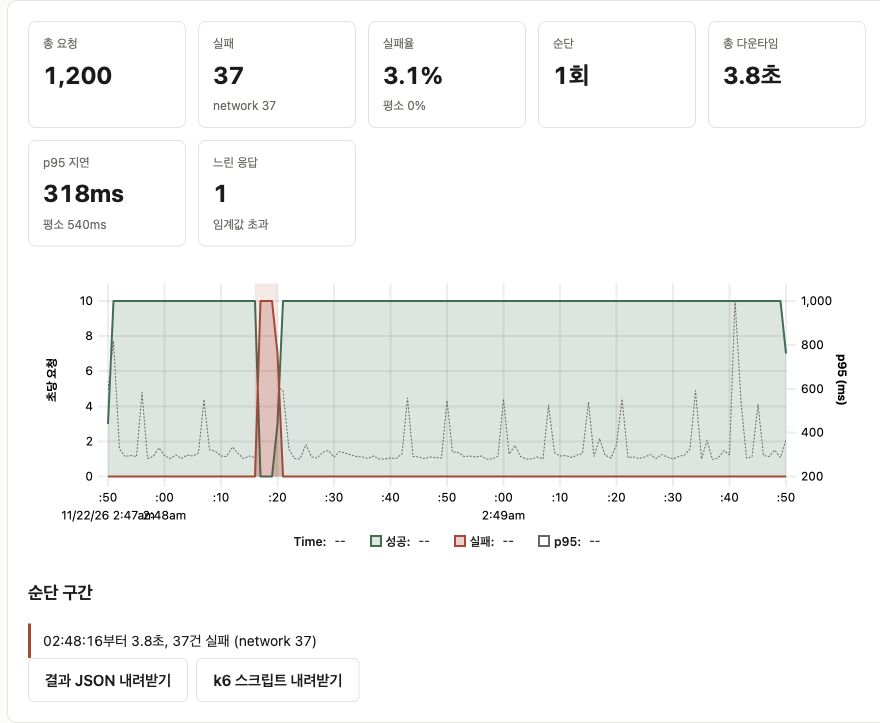
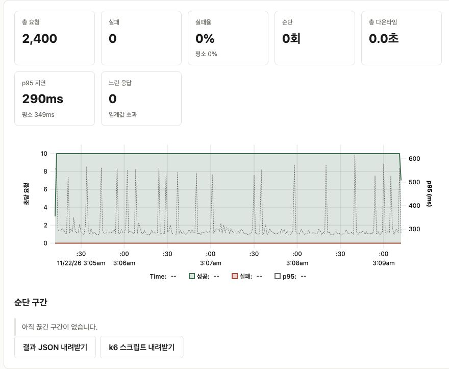
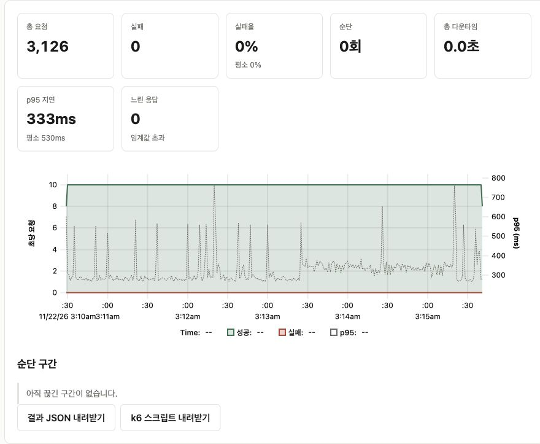
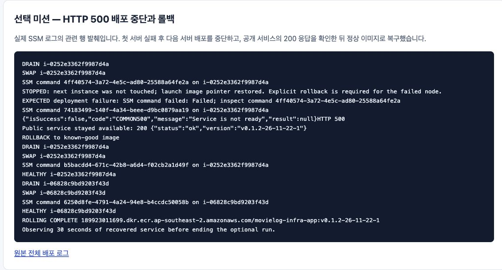
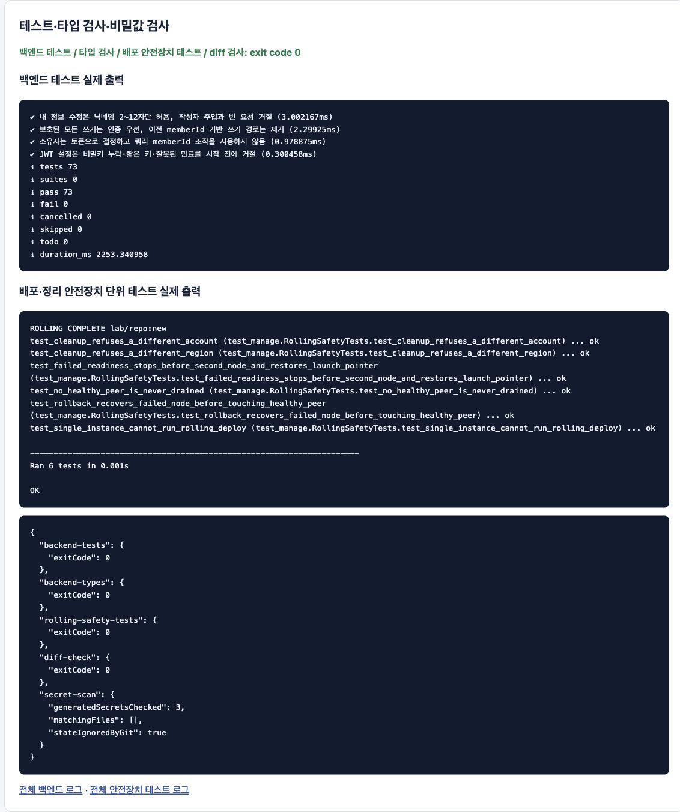
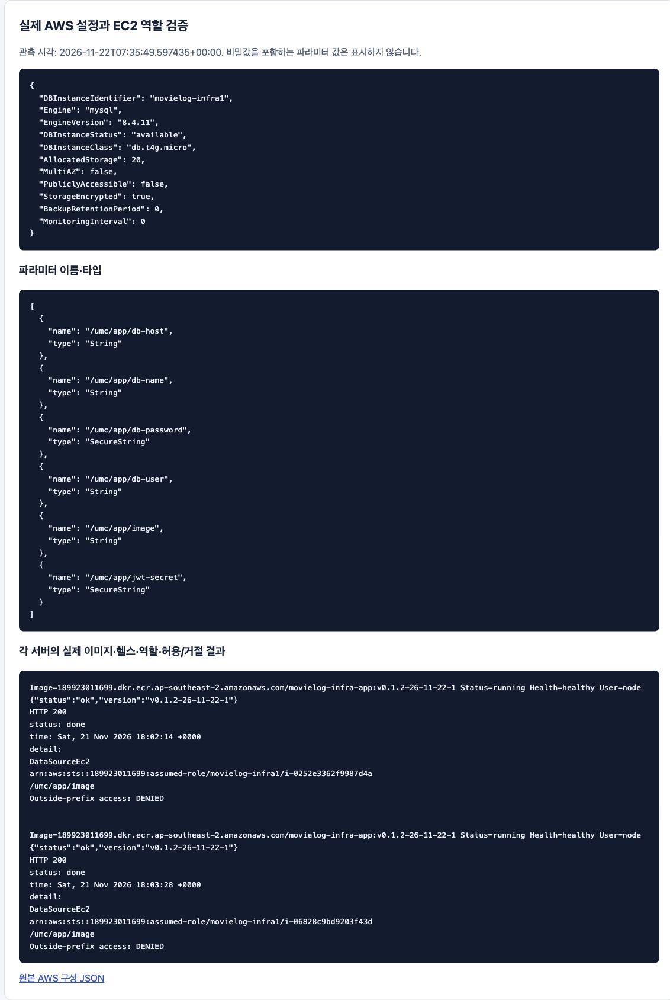
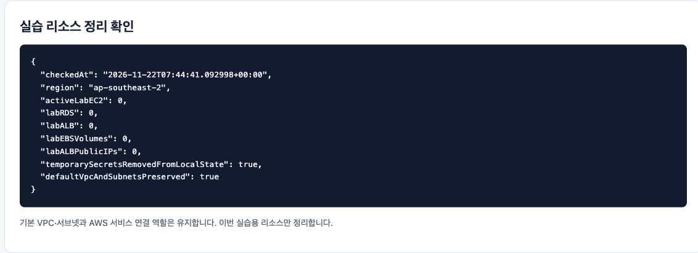

# Infra 0·1주차 노션 반영 가이드

원본 노션은 수정하지 않았다. 아래는 개인 워크북에 반영할 초안이다. 실제 스터디 사진과 본인의 이해 여부는 직접 확인해야 한다. UMC 피드백 시스템 제출도 직접 진행한다.

## 0주차 — 인사말

0주차에는 별도의 코드 미션이 없다. AWS 계정 준비 기록이 필요한 경우 개인 0주차 페이지 맨 아래 빈 블록에 `AWS 계정 준비 확인`을 추가하고 아래 문장과 사진을 넣는다. 기존 안내 본문은 지우지 않는다.

> Google 계정으로 AWS 가입과 프로젝트 생성을 완료했다. AWS 청구 화면에서 무료 플랜 적용, 가입 크레딧 $100, 미납 금액 $0을 확인했다. 실습용 CLI는 브라우저 인증으로 임시 로그인했으며 장기 Access Key를 발급하지 않았다.

사진: `infra/week0/evidence/00-free-plan-user-provided.png` — 직접 제공한 가입 직후 청구 화면이다. 이후 실습으로 크레딧이 추가되거나 사용량이 반영되면 잔액이 달라질 수 있다.

계정 준비와 워크북 제출은 별개다. UMC 시스템에서 0주차 제출을 요구하면 본인의 개인 0주차 페이지 URL을 제출한다.

## 1주차 — 워크북 위에서부터

### 학습 목표·설명 본문

학습 목표와 예제 본문은 유지한다. 본문에 있는 예시 측정값을 자신의 결과로 옮기지 않는다. 실습 기록은 아래 미션 기록에 작성한다.

### 스터디 인증

`📸 잠깐 ! 스터디 인증샷은 찍으셨나요?` 아래 이미지 칸에는 실제 스터디 사진을 넣는다. AWS 콘솔이나 테스트 결과 사진으로 스터디 참석 인증을 대신하지 않는다.

### 핵심 키워드

각 키워드를 소제목으로 만들고 다음 내용을 넣는다. 공식 자료 링크도 함께 남긴다. 읽고 설명할 수 있는지 확인한 뒤 사용한다.

**무중단 배포**

무중단 배포는 애플리케이션 버전을 교체하는 동안에도 사용자 요청을 처리할 수 있도록 트래픽과 실행 자원을 조절하는 배포 방식이다. 하나뿐인 프로세스를 종료하고 새 프로세스를 시작하면 그 사이 요청을 받을 대상이 사라진다. 여러 실행 대상과 라우팅 장치를 두면 한 대를 교체하는 동안 다른 대가 요청을 처리할 수 있다. 단순히 서버가 두 대라는 사실만으로 무중단이 보장되지는 않는다. 기존 요청의 처리 완료, 정상 서버의 남은 처리 용량, 새 버전의 준비 상태와 버전 간 호환성이 함께 필요하다.

MovieLog 실습은 같은 GET `/health` 요청으로 단일 서버 교체와 두 서버의 순차 교체를 측정한다. 실패 수뿐 아니라 실패 유형·순단·다운타임·p95·보내지 못한 요청도 확인한다. 측정 구간에서 실패가 0이어도 모든 부하와 장애에서 무중단이라는 의미로 해석하지 않는다.

**ALB — Application Load Balancer**

ALB는 HTTP·HTTPS 요청을 받아 리스너 규칙에 따라 대상 그룹으로 전달하는 애플리케이션 계층 로드 밸런서다. 사용자에게는 하나의 진입점을 제공하고, 뒤의 여러 서버로 요청을 분배한다. 주기적인 헬스 체크로 대상 상태를 판단하므로 프로세스가 실행 중인지와 실제로 요청을 처리할 수 있는지를 구분하는 경로가 필요하다.

이 실습에서는 `/health`가 DB의 `SELECT 1`까지 성공해야 200을 반환한다. DB 실패·시간 초과는 503으로 처리하고 내부 DB 오류는 응답에 노출하지 않는다. 공개 HTTP 리스너는 `/health`만 전달하고 다른 API 경로는 차단한다. ALB는 운영 부담을 줄여 주지만 사용 비용과 설정 관리가 추가된다. 등록된 대상이 전부 unhealthy인 경우의 fail-open 동작도 있으므로, 정상 대상을 하나 이상 유지하는 배포 검사가 필요하다.

참고: [AWS ALB 헬스 체크](https://docs.aws.amazon.com/elasticloadbalancing/latest/application/target-group-health-checks.html)

**타겟 그룹 draining**

Draining은 타겟을 등록 해제할 때 새 요청 전달을 중단하면서 이미 처리 중인 요청이 마무리될 시간을 주는 상태다. 등록 해제 요청 직후 컨테이너를 종료하면 진행 중이던 연결이 끊길 수 있다. `deregistration_delay`는 이 유예 시간을 설정하는 속성이다.

실습에서는 30초로 설정하고 타겟이 draining을 벗어날 때까지 기다린 다음 `docker stop -t 30`으로 컨테이너를 종료한다. ALB의 등록 해제 대기와 Docker의 종료 유예는 서로 다른 단계다. 앱에서도 SIGTERM을 처리할 수 있도록 NestJS shutdown hook과 exec 형식의 Docker CMD를 유지한다. 유예 시간이 지나치게 짧으면 요청 유실 위험이 있고, 길면 배포 시간이 늘어난다. 실제 긴 요청의 특성에 맞춰 정해야 한다.

참고: [AWS deregistration delay](https://docs.aws.amazon.com/elasticloadbalancing/latest/application/edit-target-group-attributes.html), [NestJS lifecycle events](https://docs.nestjs.com/fundamentals/lifecycle-events)

**SSM Parameter Store**

SSM Parameter Store는 애플리케이션 설정과 비밀값을 계층형 이름으로 저장하고 IAM 정책으로 접근을 제어하는 AWS 서비스다. `String`은 일반 설정, `SecureString`은 AWS KMS로 암호화하는 비밀값에 사용한다. 이름 자체는 암호화되지 않으므로 민감한 값을 파라미터 이름에 넣지 않는다.

이미지·DB 호스트·DB 사용자·DB 이름은 String, DB 비밀번호·JWT 비밀키는 SecureString으로 구분했다. EC2는 instance profile의 임시 자격 증명으로 필요한 값을 읽으며 장기 Access Key를 컨테이너에 넣지 않는다. 읽기 범위를 `/umc/app/*`로 제한했고, 관리형 SSM 정책의 넓은 GetParameter 허용이 이 범위를 우회하지 않도록 명시적인 제한도 추가했다. 중앙에서 값을 관리해 수정 지점을 줄일 수 있지만 IAM과 복호화 권한을 잘못 구성하면 앱이 시작하지 못하므로 권한 검증이 필요하다.

참고: [AWS SecureString과 KMS](https://docs.aws.amazon.com/systems-manager/latest/userguide/secure-string-parameter-kms-encryption.html)

**Rolling Update**

Rolling Update는 실행 중인 인스턴스나 컨테이너를 일부씩 순서대로 새 버전으로 교체하는 배포 방식이다. 전체 새 환경을 별도로 만드는 방식보다 추가 자원을 줄일 수 있지만, 교체 중 구버전과 신버전이 함께 서비스하므로 API와 DB 스키마의 호환성을 고려해야 한다.

배포 순서는 `정상 peer 확인 → 타겟 등록 해제·draining 대기 → 컨테이너 교체 → readiness 확인 → 타겟 재등록·healthy 대기 → 다음 서버`다. 새 버전의 헬스 체크가 실패하면 다음 서버로 넘어가지 않고 멈춘다. 이미지 태그를 버전·날짜·빌드 번호로 남겨 어떤 버전으로 복구할지 명확하게 한다. 롤백할 때는 실패해 서비스에서 빠진 서버를 먼저 복구해야 정상 서버 하나를 먼저 내리는 실수를 피할 수 있다.

참고: [AWS Auto Scaling 용량 유지](https://docs.aws.amazon.com/autoscaling/ec2/userguide/asg-capacity-limits.html)

### 학습 후기

아래는 실제 실습 과정을 바탕으로 한 초안이다. 본인의 이해나 경험과 다른 부분은 수정한다.

> 서버 두 대를 띄우는 것뿐 아니라, 어느 시점에 트래픽을 빼고 새 서버를 다시 받아들일지가 배포 안정성의 핵심이라는 점을 확인했다. 단일 서버를 교체했을 때의 요청 실패와 순단을 먼저 기록하고, 같은 요청 조건으로 ALB 뒤의 두 서버를 순차 교체해 비교하도록 구성했다.
>
> 패키지 이름과 Docker 옵션이 로컬·EC2 환경에서 다를 수 있어 실제 서버에서 검증해야 한다는 점도 확인했다. 초기 실행 오류와 사전 측정은 최종 성공 결과와 구분해 보관했다. 헬스 체크를 프로세스 실행 여부만으로 판단하지 않고 DB 연결까지 포함했으며, 실패한 서버를 먼저 복구하도록 배포 순서의 안전장치를 테스트했다.
>
> 더 학습할 부분은 긴 요청과 WebSocket에 맞는 draining 시간, 두 버전이 공존할 때의 DB 스키마 변경 방식, 실제 트래픽 증가 시 남은 한 대의 처리 용량이다. 낮은 빈도의 헬스 체크 측정만으로 모든 운영 상황의 안정성을 보장할 수는 없으므로 부하·장애 조건을 확장한 검증이 필요하다.

### 필수 미션

`🔥 미션` → `(필수)`를 열어 워크북의 before/after 표를 아래 실제 값으로 채운다.

| 항목 | 단일 배포 | 무중단 배포 |
| --- | ---: | ---: |
| 총 요청 | 1,200 | 2,400 |
| 실패 | 37 (network 37) | 0 |
| 실패율 | 3.08% | 0% |
| 순단 | 1회 | 0회 |
| 다운타임 | 3,799ms | 0ms |
| p95 | 318ms | 290ms |

공통 조건은 GET `/health`, 10 RPS, 타임아웃 5초, baseline 15초, 연속 실패 3건 이상이다. 단일 배포는 120초, 무중단 배포는 240초 측정했다. 최종 두 실행 모두 baseline 실패율 0, dropped 0, warnings 없음이다. 화면의 3.1%는 37/1,200을 반올림한 값이다. 0ms는 해당 구간의 관측 결과다.

실행 조건까지 보이는 전체 화면은 `infra/week1/evidence/01-before.jpg`, `05-after.jpg`다. 원본 `before.json`, `after.json`도 함께 보관했다.

### 선택 미션

`(선택)`에는 다음 실제 검증 결과와 사진을 넣는다. 기술 검증은 완료했다.

> `/health`가 500을 반환하는 별도 이미지를 첫 서버에 배포했다. readiness 실패 후 다음 서버 배포가 중단됐고, 실패한 서버는 타겟에서 빠진 상태로 남았다. 해당 서버 내부의 실제 HTTP 500과 실패 이미지 태그를 SSM으로 확인했다. 그동안 공개 ALB 경로는 남은 정상 서버를 통해 HTTP 200을 반환했다. 알려진 정상 이미지 v0.1.2로 실패 서버부터 복구하고 두 타겟의 healthy 복귀를 확인했다. 복구 후 30초를 추가 관측한 전체 약 313초 동안 3,126건 모두 성공했고, 순단·다운타임·dropped는 0이었다. 최대 480초로 시작한 측정을 검증 완료 후 의도적으로 종료했으므로 원본 상태는 stopped다.

`fault-rollback-deployment.txt`에는 실제 HTTP 500, 공개 경로 200, STOPPED, ROLLBACK, HEALTHY 순서가 남아 있다. 실패 배포 단계에서 두 번째 서버는 교체하지 않았고, 이후 명시적인 롤백 단계에서 순서대로 정상 버전을 확인했다.

### 미션 기록

`💪 미션 기록` 아래 `미션 기록` 토글을 열고 다음 순서로 기록한다. 최종 수치만 넣고 중간 과정을 생략하지 않는다.

1. **실습 환경**: 이름/닉네임 이가연/레아, 저장소 `https://github.com/yeonie0309/movielog`, 리전 Sydney, MovieLog NestJS·TypeORM 백엔드, private RDS MySQL, EC2 ARM64.
2. **계정·배포 준비**: 무료 플랜 확인 → 임시 CLI 로그인 → private ECR → RDS 스키마·DML 전용 앱 계정 → SecureString 설정 → EC2 부팅. 로컬 `.env`나 사용자 데이터를 이미지·AWS DB로 복사하지 않았다.
3. **단일 배포**: EC2 한 대를 측정기 IP에만 임시 허용하고 공식 도구로 GET `/health`를 10 RPS·120초 측정했다. 15초의 baseline을 확인한 뒤 실제 컨테이너를 교체했다. before JSON·사진을 첨부한다.
4. **구조 변경**: 단일 EC2 종료와 직접 접근 규칙 제거 → ALB·타겟 그룹·시작 템플릿·두 서버의 ASG 구성 → 정상 타겟 두 대 확인. 콘솔 사진과 설정 증빙을 첨부한다.
5. **무중단 배포**: 같은 요청·RPS·타임아웃 조건에서 한 대씩 draining·교체·healthy 확인 후 다음 서버를 배포한다. after JSON·사진·배포 로그를 첨부한다.
6. **선택 미션**: 별도 실패 이미지의 실제 HTTP 500, 다음 서버 교체 중단, 공개 엔드포인트 HTTP 200 유지, 정상 버전 롤백을 기록한다.
7. **검증·정리**: 백엔드 테스트·타입 검사·배포 안전장치 테스트, DB 비공개·파라미터 타입·비밀값 비노출, 실습 리소스 정리 결과를 첨부한다.
8. **PR 링크**: 생성한 이번 Infra PR 링크를 넣는다. 이전 Mobile 과제 PR과 혼동하지 않는다.

검증·정리 결과에 붙일 문장:

> 백엔드 테스트 73개와 배포·정리 안전장치 테스트 6개, 타입 검사를 통과했다. 실제 EC2 역할로 `/umc/app/image`의 이름 조회는 성공하고 경로 밖 검증 요청은 AccessDenied로 거절되는 것을 확인했다. 실습 후 EC2·RDS·ALB·EBS 볼륨·ALB 공인 IP가 모두 0개인 것을 API로 재확인하고, 실습용 IAM 역할·보안 그룹·파라미터·ECR·시작 템플릿도 정리했다. 기본 VPC·서브넷과 로컬 DB는 유지했다. 생성한 비밀값은 Git·이미지·제출 자료에 넣지 않았고, 정리 후 로컬 상태 파일에서도 제거했다.

사진 배치:

| 기록 위치 | 넣을 사진 |
| --- | --- |
| 단일 배포 측정 | `01-before-result.jpg` + 필요하면 조건이 보이는 `01-before.jpg` |
| ALB·두 서버 구성 | `02-targets-healthy.jpg` |
| draining·헬스 체크 설정 | `03-draining-30s.jpg`, `04-health-check.jpg` |
| 무중단 배포 측정 | `05-after-result.jpg` + 필요하면 `05-after.jpg` |
| 선택 미션 | `06-fault-rollback-result.jpg`, `08-fault-rollback-log.jpg` |
| 테스트 | `09-verification-log.jpg`와 원본 테스트 로그 |
| DB·설정·권한 검증 | `10-aws-security-log.jpg`와 `aws-configuration.json` |
| 자원 정리 | `11-cleanup-log.jpg`와 `cleanup.json` |

### 제출 안내·CodeRabbit·선택 활동

개인 1주차 페이지의 미션 기록을 확인한 뒤, 안내된 UMC 시스템에 직접 페이지 URL을 제출한다. 원본 공용 워크북 URL을 제출하지 않는다. 별도 블로그 챌린지나 지식in 활동을 하지 않았다면 완료로 기록하지 않는다.

### 트러블 슈팅

**1. EC2 최초 부팅 시 Docker 설치 단계 실패**

- 상황: 최초 EC2의 cloud-init이 error 상태였고 앱 초기화 명령도 중단됐다.
- 실제 원인: `dnf install -y docker awscli2`에서 `No match for argument: awscli2`가 발생했다. 선택한 AL2023 AMI에는 `/usr/bin/aws`가 이미 있었다.
- 수정: Docker만 설치하고 `command -v aws`로 기본 CLI를 확인하도록 수정했다. 새 시작 템플릿에도 같은 코드를 반영했다.
- 재검증: 기존 측정 서버를 복구한 뒤 테이블 3개 초기화와 앱 readiness를 확인했다. 이후 새 서버의 cloud-init 결과와 ALB healthy 상태도 확인한다.

**2. 로컬과 AWS Docker 버전의 종료 옵션 차이**

- 상황: 단일 서버 교체 명령이 `unknown flag: --timeout`으로 실패했고 기존 컨테이너는 교체되지 않았다.
- 원인: AWS의 Docker 25와 Mac의 Docker 29가 지원하는 긴 옵션 이름이 달랐다.
- 수정: 두 환경에서 지원하는 `docker stop -t 30`을 사용했다.
- 재검증: 실제 컨테이너 교체와 readiness 성공을 확인한 실행으로 before 측정을 다시 진행했다. 교체가 실행되지 않은 이전 측정도 별도 원본으로 보관했다.

**3. 측정 전 타임아웃·결과 화면의 실행 조건 표시**

- 상황: 첫 사전 측정에서 배포 전 요청 한 건이 2초 타임아웃으로 분류됐다. CLI로 시작한 실행을 브라우저에서 열면 폼에는 기본 POST 예제가 남는 표시 문제도 있었다.
- 판단: timeout 분류만으로 네트워크와 서버 지연 중 어느 쪽인지 확정할 수 없다. 배포 전부터 실패가 있었으므로 그 상태에서 배포를 강행하지 않았다.
- 수정: 원본을 보관하고 공식 기본값인 5초를 before/after 모두에 적용했다. 화면에는 실제 run의 export JSON을 읽어 조건을 복원하도록 UI만 보정했다.
- 재검증: baseline 실패율 0을 확인한 뒤 측정을 시작했다. 측정 엔진·통계·순단 판정 코드는 수정하지 않았으며 UI patch와 원본 도구 커밋을 공개했다.

## 완료 표시 원칙

- 기술 미션은 실제 측정·배포 로그·사진으로 확인한 항목만 완료 표시한다.
- 실제 스터디 참석·사진 첨부·개념 설명 가능 여부는 직접 확인한다.
- Notion에 옮겨 적기 전에는 기록·제출까지 완료했다고 표시하지 않는다.
- UMC 제출 버튼은 직접 누른다.
