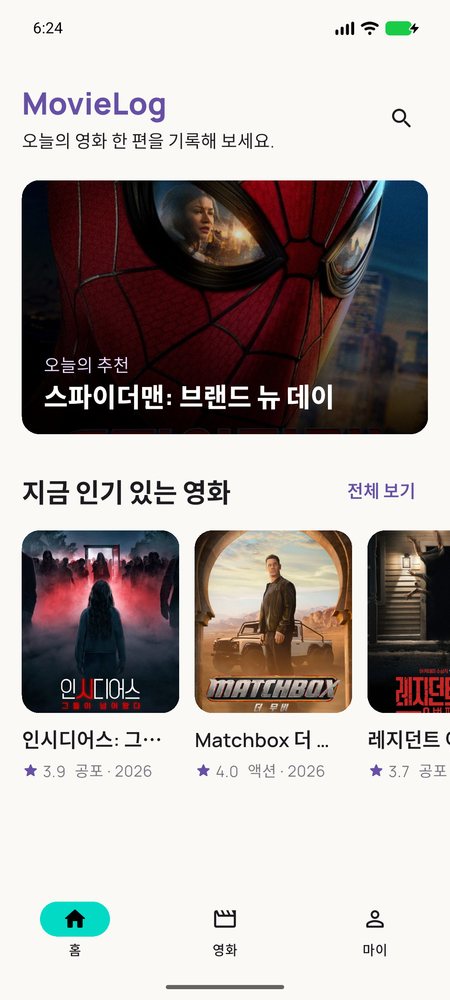
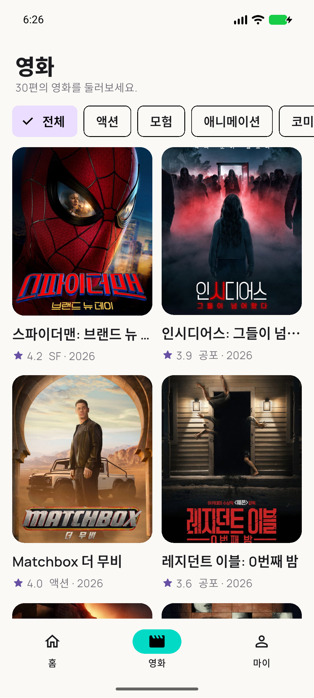
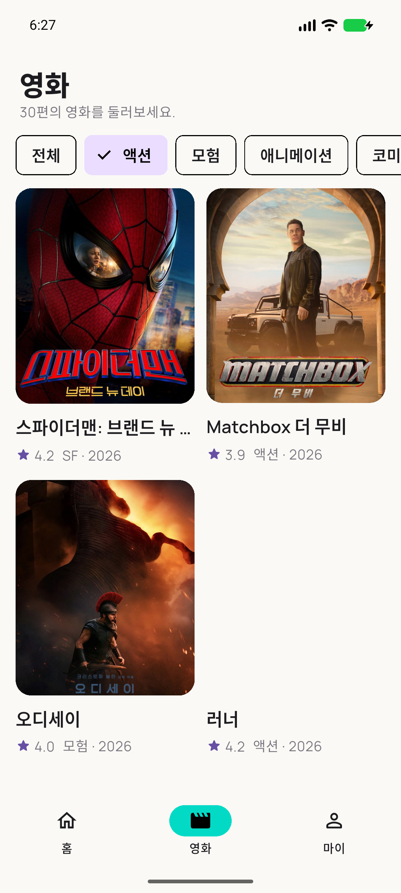
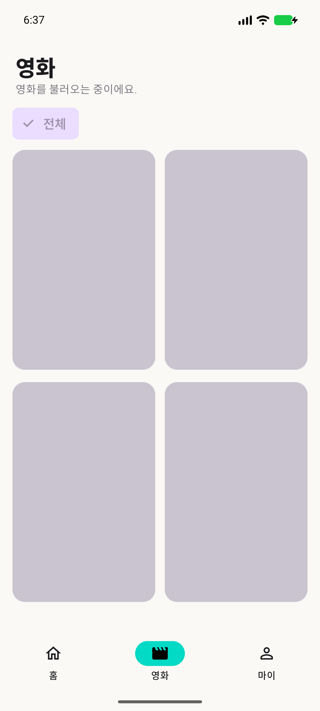
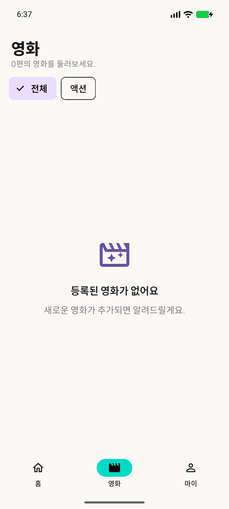
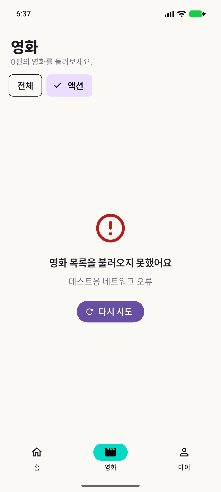
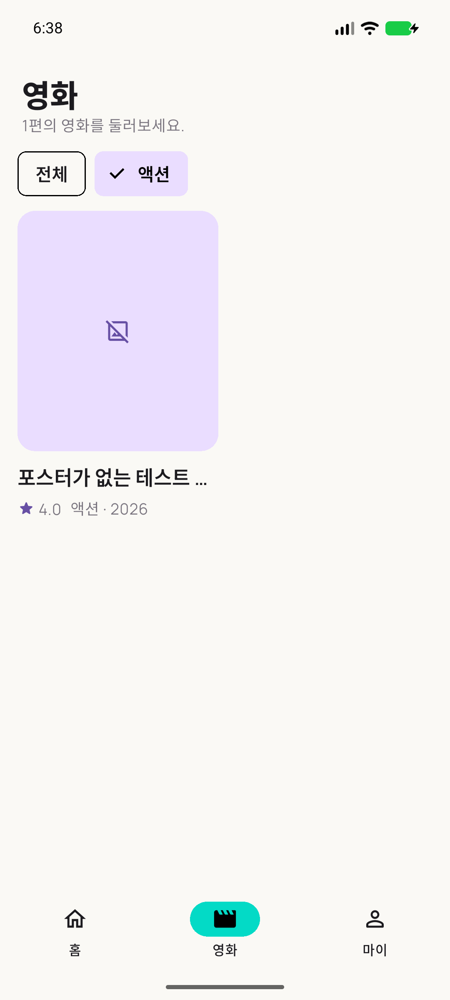

# 5주차 프론트엔드 화면

## 실제 TMDB API 응답

| 홈: Popular | Discover: 전체 30편 | Genre: 액션 선택 |
| --- | --- | --- |
|  |  |  |

홈의 인기 영화는 추천 카드 1개와 가로 목록 4개로 구성됩니다. 한 화면에는 가로 목록 일부만 보이며, 실제 5개 사용 여부는 `integration_test/week5_live_tmdb_test.dart`에서 검증했습니다. Discover의 30편도 화면 상단의 개수와 통합 테스트로 확인했습니다. 액션 칩 선택 후 `with_genres=28` 재조회는 Service 테스트와 실제 API 통합 테스트로 확인했습니다.

[장르 선택 전·후와 Network 요청 변화 영상](08-network-genre-before-after.mp4) · [실제 요청 로그](network_requests_and_test.txt)

영상은 Android 에뮬레이터의 실제 화면을 약 0.8초 간격으로 연속 캡처한 프레임 33장을 이어 만든 **무음 프레임 영상**(26.4초)입니다. 에뮬레이터 기본 `screenrecord`가 첫 화면만 반복 저장하는 문제 때문에 이 방식으로 만들었습니다. 앱 화면 하단의 검은 오버레이는 증빙용 통합 테스트가 실제 Dio 요청의 URL 경로·HTTP 상태만 표시한 것이며 토큰은 표시하지 않습니다. 영상에서 전체 → 액션(`with_genres=28`) → 전체 복귀에 따른 목록·요청 변화를 볼 수 있습니다.

## 테스트 서비스로 재현한 상태

실제 TMDB 응답을 조작한 캡처가 **아닙니다**. `integration_test/week5_evidence_test.dart`에서 결과를 제어하는 테스트 서비스를 주입하고, 같은 앱 UI를 에뮬레이터에서 캡처했습니다.

| Loading | Empty |
| --- | --- |
|  |  |

| Error와 다시 시도 버튼 | 다시 시도 성공 + 포스터 없음 placeholder |
| --- | --- |
|  |  |

테스트 순서는 Loading → Empty → 액션 장르 요청 실패(Error) → `다시 시도` 성공입니다. 마지막 영화의 `poster_path`는 `null`로 설정해 placeholder도 함께 검증했습니다. 네 상태 전환은 통합 테스트 1개가 통과했습니다.

## 검증

- [토큰 비노출 확인·Guided/Required 검증·트러블슈팅·PR 링크](verification-and-troubleshooting.md)
- [실제 TMDB 장르 전후 요청 로그와 통합 테스트 결과](network_requests_and_test.txt)
- 토큰 검사 재현: `ruby evidence/week5/verify_token_exposure.rb` (토큰 값은 출력하지 않음)
- `flutter test`: 34개 통과
- `flutter test integration_test/week5_evidence_test.dart -d emulator-5554`: 1개 통과
- `flutter test integration_test/week5_live_tmdb_test.dart -d emulator-5554`: 1개 통과
- `flutter test -d emulator-5554 integration_test/week5_network_video_test.dart`: 1개 통과 (실제 TMDB·장르 전후 요청)
- `flutter analyze --no-fatal-infos`: 종료 코드 0, 기존 0주차 `avoid_print` info 2개

원본 Notion의 화면 증빙란에는 위 이미지들을 첨부하되, 04~07번은 반드시 **테스트 서비스로 재현**했다고 표시하세요. 스터디 인증 사진은 이 저장소에서 만들 수 없으므로 실제 모임 사진을 별도로 첨부해야 합니다.
